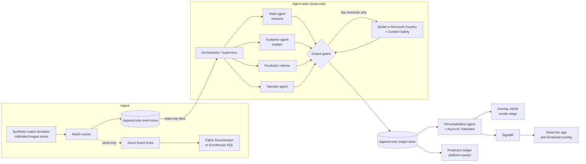

# Second Half Mind

**See the game before it turns.**

Second Half Mind is a multi-agent match intelligence engine for football. It ingests synthetic match events live, turns them into metrics (pass difficulty, shot speed, control vs chaos, pressing shifts), explains *why* key moments matter, and delivers that intelligence two ways: timed, machine-readable overlays for broadcast graphics, and a personalised experience for every fan (fan or analyst depth, favourite club, follow-a-player, a chosen metric, and their own language). Fans predict the match against an AI pundit and a statistical model, and every result is explained.

Built for the *Inside the Game* developer hackathon (Microsoft × Premier League). All clubs, players and matches are synthetic.

## The problem

- Pundits predict, but nobody checks who was right or why.
- Commentary says what happened, rarely why it mattered.
- Every fan gets the same broadcast, at one depth, in one language.

## How it works: one pipeline, five stages



| Stage | What happens | Where |
|---|---|---|
| Ingest | Passes, shots, tackles, interceptions, pressure, possession changes, corners, cards, substitutions and sprints stream in as they happen | `MatchSimulator`, `MatchRunner`, `InMemoryMatchStore`, `EventHubsMirror` |
| Interpret | Pass distance, accuracy and difficulty (0–10), ball and shot speed, xG, distance and sprint threshold alerts, milestones, control and chaos indices, tempo | `StatsAgent`, `WindowMetrics`, `PassDifficulty` |
| Explain | Live win probability; when it swings, candidate causes (goal, red card, a substitution changing the press, pressure or territory shift, shot burst, game management) are scored on measured before/after windows and the strongest is explained | `ExplainerAgent`, `InPlayModel` |
| Render | Every insight becomes a timed overlay instruction (`template`, `durationMs`, `priority`, text, data) for a graphics engine, plus a transparent broadcast view | `GET /api/matches/{id}/overlays`, `#/overlay/{id}` |
| Personalise | The same intelligence as different experiences: fan or analyst voice, favourite club, follow-a-player, a focus metric, 11 languages | `PersonalizationAgent` |

Around that pipeline:

- **Predictions:** fans call the score before kick-off and answer live micro questions ("shot on target in the next 5 minutes?") against a Poisson model trained on three seasons of league history and an AI pundit persona that trusts form and instinct. The referee agent resolves each one from the event stream and explains who was right.
- **Narratives:** half-time and full-time recaps compare the scoreline with the chances, name the turning point and the player of the match.
- **Data innovation:** every match exports as JSON Lines; the tools generate whole synthetic seasons; Fabric KQL queries in `fabric/` analyse them.

## Security and guardrails

Agents can read match data but cannot modify or delete it. This is enforced by structure and verified by tests, not by convention:

1. **Compile-time isolation.** The agents project references only the domain contracts. It has no reference to the data layer, so agent code cannot even name the stores.
2. **Read-only interfaces.** Agents receive `IMatchReadModel`, `ILeagueReadModel`, `IInsightReadModel` and `IFanPredictionReadModel`, which only expose `Get`/`List` methods. Their single output is `IInsightSink.Publish`, an append-only store separate from match data.
3. **No update or delete anywhere.** The write interfaces (`[DataWriteCapability]`) are append-only by design. The event store rejects duplicated or reordered events.
4. **Architecture tests in CI** fail the build if any agent type depends on a write capability, if a write interface gains an update or delete method, or if the agents assembly references the data layer.
5. **Language models only rephrase.** They get verified facts, no tools, and never any fan-typed text. Output must pass the output guard: every number must match a fact, only players in this match may be named, no betting language, links, mentions or markup, and length limits. It then passes Azure AI Content Safety, or the deterministic template is used. Every decision is in the audit log, shown in the app.
6. **Keyless in Azure.** Managed identity everywhere, local auth disabled on Event Hubs and AI services, the app identity can only *send* events, secrets live in Key Vault, and CI deploys with OIDC.

Details in [docs/SECURITY.md](docs/SECURITY.md).

## Data and compliance

The hackathon requires synthetic data, and no real Premier League data is redistributed. Real historical results are used **only** to calibrate league-level behaviour: the calibration tool downloads the last three completed English top-flight seasons, keeps them in memory, and writes out anonymous averages (home/draw/away rates, goals, shots, corners, cards, the spread of team strengths). No club names, player names or match rows are stored or shipped. The synthetic league is then built to behave like the real one. See [docs/DATA.md](docs/DATA.md).

## Microsoft technologies

| Technology | Use |
|---|---|
| .NET 8, ASP.NET Core, SignalR | API, agent host, realtime push |
| Microsoft Foundry (Azure OpenAI deployment) | Optional voice for the biggest moments, behind the output guard |
| Azure AI Content Safety | Second check on generated text |
| Azure AI Translator | Multilingual overlays |
| Azure Event Hubs | Send-only mirror of the live event stream |
| Microsoft Fabric Real-Time Intelligence | Eventstream into Eventhouse; KQL analytics in `fabric/` |
| Azure Container Apps, Container Registry, Key Vault, Log Analytics | Hosting, images, secrets, logs (`infra/main.bicep`) |
| GitHub Actions | CI with build, tests and npm audit; OIDC deployment |

Every Azure service is optional at runtime. With none configured the app runs fully offline on templates.

## Run it locally

Prerequisites: .NET 8 SDK and Node.js 20.

```bash
# API on http://localhost:5080
dotnet run --project src/SecondHalfMind.Api

# Web app with hot reload on http://localhost:5173 (proxies to the API)
cd web && npm install && npm run dev
```

Or build the web app into the API and serve both from one port:

```bash
cd web && npm install && npm run build && cd ..
dotnet run --project src/SecondHalfMind.Api   # open http://localhost:5080
```

Open a fixture, lock in a prediction, go back and press **Kick off** (20x speed plays a match in about 4.5 minutes), then open the match. Switch between **Fan** and **Analyst**, pick a language, a club, a player to follow, and open **How this was made** to see the agents and guardrails at work.

### Calibrate from real history (optional)

```bash
dotnet run --project src/SecondHalfMind.Tools -- calibrate
# or, offline, with CSVs you downloaded yourself:
dotnet run --project src/SecondHalfMind.Tools -- calibrate --file E0-2324.csv --file E0-2425.csv --file E0-2526.csv
```

This writes `src/SecondHalfMind.Api/data/calibration.json`. Until then the app uses approximate default priors and says so in the UI.

### Generate a synthetic dataset

```bash
dotnet run --project src/SecondHalfMind.Tools -- generate --matches 50 --out datasets
```

### Turn on Azure AI services (optional)

Use user secrets locally, never `appsettings.json`:

```bash
cd src/SecondHalfMind.Api
dotnet user-secrets set "AI:FoundryEndpoint" "https://<your-resource>.openai.azure.com"
dotnet user-secrets set "AI:ChatDeployment" "gpt-4o-mini"
dotnet user-secrets set "AI:FoundryApiKey" "<key>"
dotnet user-secrets set "AI:TranslatorKey" "<key>"
dotnet user-secrets set "AI:TranslatorRegion" "<region>"
```

## Deploy to Azure

```bash
az group create -n second-half-mind -l swedencentral
az deployment group create -g second-half-mind -f infra/main.bicep -p operatorKey=<a-long-random-secret>
```

Then run the **Deploy to Azure** workflow (OIDC: set `AZURE_CLIENT_ID`, `AZURE_TENANT_ID`, `AZURE_SUBSCRIPTION_ID`, `AZURE_RESOURCE_GROUP` as repository variables). Point a Fabric Eventstream at the `match-events` hub, consumer group `fabric`, and run `fabric/match-events.kql` in your Eventhouse.

## Tests

```bash
dotnet test
```

Covers the architecture rules above, the output guard, whole-match pipeline runs (every template passes the guard, the event log is never altered, replays are rejected), the prediction ledger, the models and input validation.

## API

| Method | Path | Purpose |
|---|---|---|
| GET | `/api/matches`, `/api/matches/{id}` | Fixtures and live state |
| GET | `/api/matches/{id}/briefing` | Model call, pundit call, storylines |
| GET | `/api/matches/{id}/overlays?mode=&language=&club=&player=&metric=` | Personalised, timed overlay JSON |
| GET | `/api/matches/{id}/insights`, `/winprob`, `/squads`, `/leaderboard`, `/question` | Agent output and match data (read-only) |
| GET | `/api/matches/{id}/events.jsonl` | Synthetic event stream export |
| GET | `/api/audit?matchId=` | Agent and guardrail decisions |
| POST | `/api/matches/{id}/picks`, `/answers` | Fan predictions (validated, rate-limited) |
| POST | `/api/ops/matches`, `/api/ops/matches/{id}/start` | Match control (operator key) |
| WS | `/hubs/match` | Snapshots, win probability, overlays, leaderboard |

## Project structure

```
src/
  SecondHalfMind.Domain       Contracts: events, insights, overlays, read-only and write interfaces
  SecondHalfMind.Simulation   Fictional league, history and event-level match simulator
  SecondHalfMind.Data         Platform-owned stores: events, insights, prediction ledger, audit
  SecondHalfMind.Agents       Agents, models, guardrails, Azure AI clients (Domain reference only)
  SecondHalfMind.Api          ASP.NET Core host, SignalR, security, Event Hubs mirror
  SecondHalfMind.Tools        Calibration and dataset generation
tests/SecondHalfMind.Tests    xUnit tests, including architecture tests
web/                          React + TypeScript fan app and broadcast overlay
infra/main.bicep              Azure resources with least-privilege RBAC
fabric/match-events.kql       Eventhouse table, mapping and analytics
```

## Limitations and next steps

- State is in memory in this reference build, so the app runs as a single replica. Production would back the same interfaces with Cosmos DB and the Eventhouse.
- Auto-eventing (deriving events from a video feed) is out of scope; the event contract is ready for it.
- The AI pundit is a rule-based persona; its reasoning is shown to fans as such.

## License

MIT
